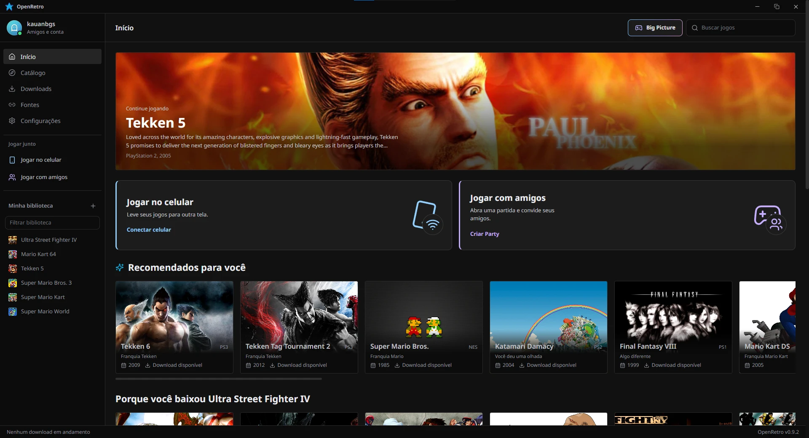

<h1>OpenRetro</h1>

<b>OpenRetro is an open-source launcher for classic games. It keeps your whole retro library in one place, from NES to PlayStation 3, and lets you play it on the PC, on your phone or online with friends. It's written in React, TypeScript and Rust (Tauri).</b>

  

## Features

- Keep all your classic games in one library, with covers and details
- Press play: the emulator comes built in and sets itself up
- Play everything from NES and SNES up to PS2 and PS3
- Use your phone as a second screen and controller, with no app needed
- Open a Party and play online with your friends
- Add friends, chat and see what everyone is playing
- Unlock achievements with RetroAchievements
- Get recommendations and discover games you haven't played yet
- Play from the couch in Big Picture mode, with a controller
- Show what you're playing on Discord
- Download games from your own sources, since none are included

## Download

Get the latest version from the [Releases](https://github.com/kauanbgs/openretro/releases/latest) page.

## Build from source and contributing

Everything about running, building and how things work is in the [developer guide](docs/DEVELOPMENT.md).

## License

The app code is under the [MIT license](LICENSE). The bundled emulators (RetroArch and RPCS3) keep their own GPL licenses. The [developer guide](docs/DEVELOPMENT.md#license) has the details.
